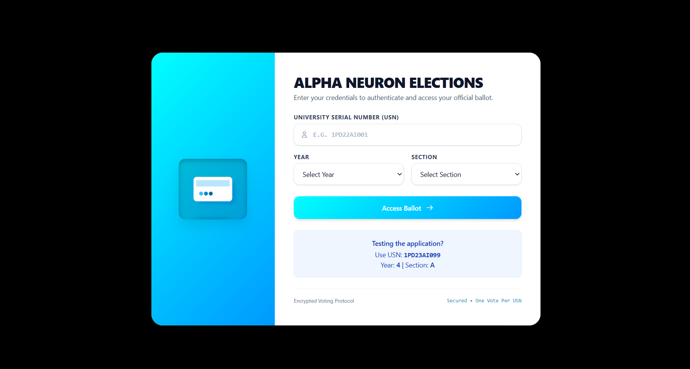
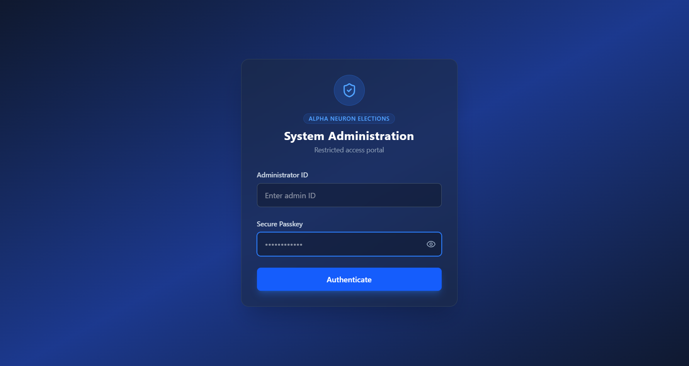

# 🗳️ Alpha Neuron Elections

<p align="center">
  
</p>

<h3 align="center">Your Vote. Your Voice. Your Future.</h3>

<p align="center">
  A modern electronic voting platform designed for student elections, with a focus on eligibility validation, controlled access, and voting integrity.
</p>

<p align="center">
  <strong>Department of Artificial Intelligence & Machine Learning</strong>
</p>

<p align="center">
  <a href="https://e-voting-portal-nu.vercel.app/login">
    
  </a>
  <a href="https://e-voting-portal-nu.vercel.app/admin/login">
    
  </a>
</p>

<p align="center">
  
  
  
  
</p>

<p align="center">
  <a href="#-features">Features</a> •
  <a href="#-application-preview">Screenshots</a> •
  <a href="#-security">Security</a> •
  <a href="#-tech-stack">Tech Stack</a> •
  <a href="#-getting-started">Getting Started</a> •
  <a href="#-contributing">Contributing</a>
</p>

---

## 📖 About the Project

**Alpha Neuron Elections** is a full-stack electronic voting platform developed to simplify and modernize student elections.

The application provides separate authentication interfaces for students and administrators. Its voting workflow is designed around student eligibility validation, controlled access, candidate selection, and the prevention of duplicate vote submissions.

Built using the MERN ecosystem, the project brings together modern frontend development, backend API design, database operations, and practical web security concepts.

### 🎯 Project Objectives

- Digitize the student election process.
- Validate student eligibility using configured academic information.
- Enforce one successful vote per eligible voter per election.
- Separate student and administrator access.
- Simplify election administration and results management.
- Apply security-conscious practices to authentication and API development.

---

## 🌐 Live Demo

Explore the deployed application using the links below.

| Portal | Description | Link |
|---|---|---|
| 🎓 Student Portal | Student authentication and ballot access | [Open Student Portal](https://e-voting-portal-nu.vercel.app/login) |
| 🛡️ Administrator Portal | Dedicated administrator authentication | [Open Admin Portal](https://e-voting-portal-nu.vercel.app/admin/login) |

**Note:** Access to protected features requires valid authorization. The availability of individual features depends on the current deployment and election configuration.

---

## 🖥️ Application Preview

### 🎓 Student Login Interface

The student portal provides an interface for entering a University Serial Number (USN), academic year, and section before accessing the configured voting workflow.

<p align="center">
  
</p>

<p align="center">
  <a href="https://e-voting-portal-nu.vercel.app/login">**Launch Student Portal →**</a>
</p>

### 🛡️ Administrator Login Interface

The administrator portal provides a separate authentication interface for authorized personnel responsible for election administration.

<p align="center">
  
</p>

<p align="center">
  <a href="https://e-voting-portal-nu.vercel.app/admin/login">**Launch Administrator Portal →**</a>
</p>

---

## ✨ Features

### 🗳️ Student Voting

- **Cohort-Based Eligibility:** Validate student details against the configured USN, academic year, and section.
- **Dedicated Student Portal:** Provide a focused interface for student authentication.
- **Candidate Voting Workflow:** Support candidate selection through the configured ballot interface.
- **Duplicate-Vote Prevention:** Apply server-side eligibility checks and appropriate conditional database operations.
- **Structured User Experience:** Present a clear interface for accessing the election workflow.

### 🛡️ Administrator Access

- **Separate Admin Login:** Keep administrator authentication distinct from the student portal.
- **Role-Based Authorization:** Restrict administrative operations to authorized users.
- **Election Administration:** Support configured candidate and election management functionality.
- **Results Access:** Provide access to election tabulation and results functionality where implemented.

### 🔐 Security-Focused Engineering

- **JWT Authentication:** Authenticate requests to protected endpoints using JSON Web Tokens.
- **Role-Based Access Control (RBAC):** Separate student and administrator permissions.
- **API Rate Limiting:** Help mitigate brute-force attempts and repeated request abuse.
- **Security Headers:** Use Helmet to configure HTTP security headers, if enabled in the backend.
- **Input Validation:** Validate incoming data and use safe database query patterns.
- **Restricted File Uploads:** Apply file-type and size restrictions where candidate image uploads are supported.
- **Environment-Based Configuration:** Keep sensitive configuration out of committed source code.

---

## 🔒 Security Architecture

Security is an important engineering consideration in Alpha Neuron Elections.

| Security concern | Mitigation approach |
|---|---|
| Unauthorized access | Authentication and protected API endpoints |
| Privilege escalation | Server-side role and permission checks |
| Duplicate voting | Conditional database operations and eligibility enforcement |
| Brute-force attempts | Rate limiting on relevant endpoints |
| NoSQL injection | Input validation and safe query construction |
| Unsafe uploads | File-type validation and upload size restrictions where applicable |
| Secret exposure | Environment variables and secret management |
| HTTP security | Security headers and HTTPS in production |

### Preventing Duplicate Votes

Concurrent requests are an important consideration in electronic voting systems.

A simple check-then-write workflow may introduce a race condition if multiple requests check voter eligibility before either request updates the database.

A more robust approach is to enforce the eligibility condition as part of an atomic database operation, such as MongoDB's `findOneAndUpdate()`, when appropriate to the application's data model.

This helps prevent concurrent requests from successfully claiming the same voting eligibility.

The overall guarantee depends on the actual implementation, including data modeling, unique constraints, vote persistence, authorization, transaction requirements, and concurrency testing.

### Security Disclaimer

Alpha Neuron Elections is a security-focused application project. It has not been independently certified as a secure election system.

Claims of complete anonymity, end-to-end verifiability, or tamper-proof operation require additional implementation, testing, and independent security review.

---

## 🧰 Tech Stack

| Technology | Purpose |
|---|---|
| JavaScript (ES6+) | Application logic |
| React | Frontend user interface |
| Vite | Frontend development and build tooling |
| Tailwind CSS / CSS | Interface styling |
| Node.js | Backend runtime |
| Express.js | Backend framework and API routing |
| MongoDB | Data storage |
| Mongoose | MongoDB object modeling |
| JSON Web Tokens | Authentication |
| Helmet | HTTP security headers, if configured |
| Express Rate Limit | Request rate limiting, if configured |
| Multer | File uploads, where used |
| Vercel | Deployed frontend |
| MongoDB Atlas | Managed database hosting, if configured |

The list should reflect the packages and services actually used by the repository.

---

## 🏗️ System Architecture

Alpha Neuron Elections follows a client-server architecture.

```text
                 ┌──────────────────────┐
                 │    Student / Admin    │
                 └──────────┬───────────┘
                            │
                 ┌──────────▼───────────┐
                 │     React + Vite     │
                 │     Frontend UI      │
                 └──────────┬───────────┘
                            │
                       HTTPS / REST
                            │
                 ┌──────────▼───────────┐
                 │   Node.js + Express  │
                 │                      │
                 │ Authentication       │
                 │ Authorization        │
                 │ Input Validation     │
                 │ Voting Logic         │
                 └──────────┬───────────┘
                            │
                 ┌──────────▼───────────┐
                 │   MongoDB + Mongoose │
                 │                      │
                 │ Student Records      │
                 │ Election Data        │
                 │ Vote Records         │
                 │ Candidate Data       │
                 └──────────────────────┘
```

The exact entities and data relationships depend on the implemented database schema.

---

## 📂 Project Structure

The repository separates frontend and backend code and keeps project documentation at the root.

```text
e-voting-portal/
├── client/
│   ├── public/
│   │   └── election-preview.jpg
│   └── ...
├── server/
│   ├── config/
│   ├── controllers/
│   │   ├── adminController.js
│   │   ├── authController.js
│   │   └── votingController.js
│   ├── middleware/
│   ├── models/
│   ├── routes/
│   ├── utils/
│   ├── server.js
│   ├── package.json
│   └── .env
├── docs/
│   └── screenshots/
│       ├── student-login.png
│       └── admin-login.png
├── .gitignore
└── README.md
```

This is a representative structure based on the files identified in the project. Additional files may exist in the frontend and backend directories.

---

## 🚀 Getting Started

Follow these steps to run the application locally.

### Prerequisites

Install the following tools:

- [Node.js](https://nodejs.org/) — version 18 or later, depending on project dependencies.
- [Git](https://git-scm.com/).
- [MongoDB Atlas](https://www.mongodb.com/atlas) or a local MongoDB instance.

### 1. Clone the Repository

```bash
git clone https://github.com/UMESH-KALE0777/e-voting-portal.git
cd e-voting-portal
```

### 2. Install Backend Dependencies

```bash
cd server
npm install
```

### 3. Configure Backend Environment Variables

Create a `.env` file inside `server/`.

Example configuration:

```env
PORT=5000
MONGO_URI=your_mongodb_connection_string
JWT_SECRET=your_strong_random_secret
CLIENT_URL=http://localhost:5173
```

Use the exact variable names expected by your backend. Additional variables may be required depending on the implementation.

**Security reminders:**

- Never commit real credentials or `.env` files.
- Use strong, randomly generated secrets.
- Configure production secrets through your hosting provider.
- Use appropriately scoped database credentials.
- Do not expose private credentials in frontend environment variables.

### 4. Start the Backend

From the `server/` directory:

```bash
npm start
```

If your `package.json` defines a different start script, use the configured script.

### 5. Install and Start the Frontend

Open a second terminal from the repository root:

```bash
cd client
npm install
npm run dev
```

Open the local URL displayed by Vite, typically:

http://localhost:5173

The backend typically runs on:

http://localhost:5000

Ensure the frontend API URL and backend CORS configuration match your local environment.

---

## ☁️ Deployment

The student and administrator login interfaces are deployed on Vercel.

A typical full-stack deployment can use:

| Component | Platform |
|---|---|
| Frontend | Vercel |
| Backend API | Render or another Node.js-compatible host |
| Database | MongoDB Atlas |

### Production Checklist

- [ ] Configure production environment variables.
- [ ] Restrict CORS to approved frontend origins.
- [ ] Enforce HTTPS.
- [ ] Protect administrative endpoints with server-side authorization.
- [ ] Use strong authentication secrets and scoped database credentials.
- [ ] Validate incoming API data.
- [ ] Test duplicate and concurrent voting attempts.
- [ ] Verify database failure handling and recovery.
- [ ] Avoid exposing sensitive voter information in public responses or logs.
- [ ] Test the application on desktop and mobile devices.

---

## 🧪 Testing & Reliability

Recommended test cases include:

- [ ] Reject students who do not meet eligibility requirements.
- [ ] Reject repeated vote submissions.
- [ ] Test simultaneous vote requests from the same voter.
- [ ] Block unauthorized access to administrator endpoints.
- [ ] Reject malformed request payloads.
- [ ] Verify rate-limiting behavior on relevant endpoints.
- [ ] Reject unsupported or oversized uploads where applicable.
- [ ] Verify consistency between stored votes and displayed results.
- [ ] Test error handling when the database is unavailable.

These are recommended tests, not claims that every test has already been implemented or passed.

---

## 🗺️ Future Improvements

Potential improvements for future releases include:

- [ ] Automated frontend and backend tests.
- [ ] Continuous integration for linting and testing.
- [ ] Improved election lifecycle management.
- [ ] Administrative audit logs.
- [ ] Enhanced monitoring and error reporting.
- [ ] Accessibility and responsive design improvements.
- [ ] Documented threat modeling and independent security review.
- [ ] Stronger election auditability and privacy protections.

Have an idea for an improvement? Contributions and constructive feedback are welcome.

---

## 🤝 Contributing

Contributions are welcome! You can help improve Alpha Neuron Elections by fixing bugs, improving the interface, strengthening security, writing tests, or suggesting new features.

### Contribution Workflow

**1. Fork the repository**

Create your own fork on GitHub.

**2. Create a feature branch**

```bash
git checkout -b feature/your-feature
```

**3. Commit your changes**

```bash
git add .
git commit -m "feat: describe your improvement"
```

**4. Push your branch**

```bash
git push origin feature/your-feature
```

**5. Open a Pull Request**

Describe your changes, explain the problem they solve, and include relevant screenshots or test results.

For larger changes, consider opening an issue first to discuss your proposal.

---

## 🐛 Issues & Feature Requests

Found a bug or have an idea for improvement?

Open an issue in the repository and include:

- A clear description of the problem.
- Steps to reproduce it.
- Expected and actual behavior.
- Relevant screenshots or sanitized error messages.

Never include real student credentials, private voter records, passwords, or secrets in public issues.

---

## 📄 License

This project is intended to use the MIT License. Ensure that the repository contains a valid `LICENSE` file before describing the project as MIT-licensed.

See [LICENSE](./LICENSE) for the complete license text.

---

## ⭐ Support the Project

If you find Alpha Neuron Elections useful, interesting, or educational, consider giving the repository a star ⭐ on GitHub.

Your support helps other developers discover the project and encourages continued work on security-conscious web applications.

Found a bug? Have an idea? Contributions and constructive feedback are welcome.

<p align="center">
  <strong>Alpha Neuron Elections</strong>
  <br />
  Your Vote. Your Voice. Your Future.
  <br /><br />
  ⭐ Star the repository if you find it useful!
</p>
