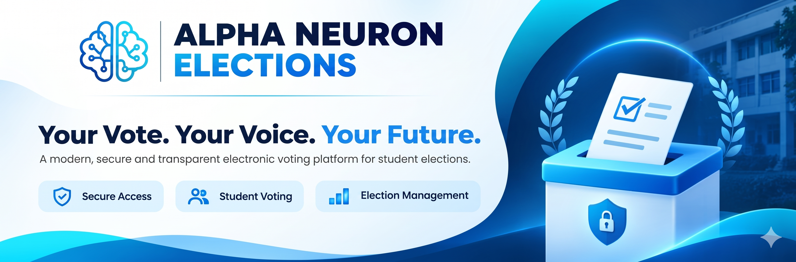

# 🗳️ Alpha Neuron Elections

<p align="center">
  
</p>

<h3 align="center">
  A Security-Focused Electronic Voting Platform for Student Elections
</h3>

<p align="center">
  Built for the Department of Artificial Intelligence and Machine Learning
</p>

<p align="center">
  
  
  
  
</p>

<p align="center">
  <a href="#-features">Features</a> •
  <a href="#-security-architecture">Security</a> •
  <a href="#-tech-stack">Tech Stack</a> •
  <a href="#-getting-started">Getting Started</a> •
  <a href="#-contributing">Contributing</a>
</p>

---

## 📌 Overview

**Alpha Neuron Elections** is a full-stack electronic voting platform designed to make student elections more organized, accessible, and reliable.

Developed for the Department of Artificial Intelligence and Machine Learning, the platform combines a modern React interface with a Node.js and Express backend, backed by MongoDB.

The project focuses on a critical challenge in online elections: **ensuring that only eligible students can vote and that each eligible voter can cast only one vote per election.**

From cohort-based voter validation and protected authentication flows to conditional database updates and administrative result dashboards, Alpha Neuron Elections brings important security engineering concepts into a practical application.

### 🎯 Why This Project?

Traditional student elections can involve manual voter verification, paper ballots, time-consuming counting, and avoidable administrative overhead.

Alpha Neuron Elections aims to simplify that process through:

- **Eligibility validation** — restrict voting to the intended student cohort.
- **Duplicate-vote prevention** — enforce voting eligibility through database-level conditional updates.
- **Protected access** — separate student and administrator capabilities.
- **Digital tabulation** — make election results easier to review.
- **Secure API design** — apply layered protections to authentication and application endpoints.

> Built to explore how authentication, database consistency, and web security principles can be applied to real-world voting workflows.

---

## ✨ Features

### 🗳️ Voting & Election Management

- **Cohort-Based Eligibility:** Validate voters against the configured University Serial Number (USN), academic year, and section.
- **Single-Vote Enforcement:** Use conditional database operations to prevent multiple successful votes for the same voter.
- **Election Results Dashboard:** Present election results and vote distributions through a centralized interface.
- **Candidate Management:** Support candidate information and image handling through the application backend.
- **Student Voting Workflow:** Provide an interface for eligible students to participate in an election.

### 🔐 Authentication & Security

- **JWT Authentication:** Protect authenticated routes using JSON Web Tokens.
- **Role-Based Access Control:** Separate student and administrator permissions.
- **API Rate Limiting:** Limit repeated requests to help mitigate brute-force attempts and abuse.
- **Security Headers:** Use Helmet to configure HTTP security headers.
- **Input Validation & Sanitization:** Validate incoming data and reduce exposure to malformed requests and NoSQL injection patterns.
- **Protected Media Uploads:** Apply upload restrictions, MIME-type validation, and file-size limits.
- **Credential Verification:** Use appropriate cryptographic comparison techniques where applicable.

### ⚡ Modern Full-Stack Architecture

- React-based frontend powered by Vite.
- REST API built with Node.js and Express.
- MongoDB database with Mongoose.
- Environment-based configuration for deployment.
- Frontend and backend designed for separate hosting.

---

## 🛡️ Security Architecture

Security is a core engineering concern in Alpha Neuron Elections, not just an additional feature.

| Security concern | Approach |
|---|---|
| Unauthorized access | JWT authentication and protected routes |
| Privilege escalation | Role-based authorization checks |
| Duplicate voting | Conditional database updates and eligibility checks |
| Brute-force attempts | Rate limiting on relevant endpoints |
| NoSQL injection | Input validation and safe query construction |
| Malicious file uploads | File-type restrictions and upload size limits |
| Sensitive configuration | Environment variables for secrets and connection strings |
| HTTP security | Helmet security headers |

### Preventing Duplicate Votes

A key design consideration is the time-of-check to time-of-use (TOCTOU) problem.

Checking whether a student has voted and then recording a vote in separate, unprotected operations can allow concurrent requests to pass the same initial check.

The intended approach is to enforce the eligibility condition as part of a conditional database update, for example using MongoDB's `findOneAndUpdate()` where the data model supports the required atomic operation.

This reduces the possibility of concurrent requests successfully claiming the same voting eligibility.

**Important:** Database atomicity alone does not guarantee a completely tamper-proof election. Correctness also depends on the data model, unique constraints, vote-recording logic, transaction boundaries where needed, authorization, and testing under concurrent requests.

### Security Disclaimer

This project demonstrates security-focused application engineering. It has not been independently certified as a secure election system.

Before use in high-stakes public elections, it would require independent security audits, privacy analysis, end-to-end verifiability, stronger operational controls, and comprehensive testing.

---

## 🧰 Tech Stack

| Category | Technologies |
|---|---|
| Language | JavaScript (ES6+) |
| Frontend | React, Vite |
| Styling | Tailwind CSS and/or custom CSS |
| Backend | Node.js, Express.js |
| Database | MongoDB, MongoDB Atlas |
| Data modeling | Mongoose |
| Authentication | JSON Web Tokens (JWT) |
| Security | Helmet, Express Rate Limit, input validation |
| File uploads | Multer |
| Frontend deployment | Vercel |
| Backend deployment | Render |
| Database hosting | MongoDB Atlas |

---

## 🏗️ Architecture

```text
┌──────────────────────────────┐
│        Student / Admin       │
└──────────────┬───────────────┘
               │
               ▼
┌──────────────────────────────┐
│       React + Vite UI        │
│   Voting / Admin Dashboard   │
└──────────────┬───────────────┘
               │ HTTPS / REST API
               ▼
┌──────────────────────────────┐
│      Node.js + Express       │
│                              │
│  Authentication & RBAC       │
│  Input Validation            │
│  Rate Limiting               │
│  Voting & Election Logic     │
└──────────────┬───────────────┘
               │
               ▼
┌──────────────────────────────┐
│       MongoDB + Mongoose     │
│                              │
│  Voter Eligibility           │
│  Election Data               │
│  Vote Records                │
│  Candidate Information       │
└──────────────────────────────┘
```

---

## 📸 Screenshots

Screenshots help developers understand the project before installing it.

Add screenshots of the actual application below. Replace the example paths with images stored in your repository.

| Student Voting Interface | Election Results |
|---|---|
| `docs/screenshots/voting.png` | `docs/screenshots/results.png` |

You can display the screenshots directly using Markdown:

```md


```

Consider adding screenshots of the administrator dashboard, candidate selection, and responsive mobile interface as well.

---

## 🚀 Getting Started

Follow these instructions to run Alpha Neuron Elections locally.

### Prerequisites

Install the following before getting started:

- [Node.js](https://nodejs.org/) — version 18 or later, subject to your dependencies.
- [Git](https://git-scm.com/)
- A [MongoDB Atlas](https://www.mongodb.com/atlas) cluster or local MongoDB instance.

### 1. Clone the Repository

Replace the repository URL with the actual GitHub URL.

```bash
git clone https://github.com/YOUR-USERNAME/YOUR-REPOSITORY.git
cd YOUR-REPOSITORY
```

### 2. Configure the Backend

Create a `.env` file inside the `server/` directory.

```env
PORT=5000
MONGO_URI=your_mongodb_connection_string
JWT_SECRET=replace_with_a_strong_random_secret
CLIENT_URL=http://localhost:5173
ADMIN_USERNAME=your_admin_username
ADMIN_PASSWORD=your_admin_password
```

Use the environment variable names expected by your actual backend implementation.

**Never commit `.env` files, database credentials, administrator passwords, or JWT secrets to GitHub.** Add them to `.gitignore` and configure production secrets through your hosting provider.

### 3. Configure the Frontend

Create a `.env` file inside the `client/` directory.

```env
VITE_API_URL=http://localhost:5000/api
```

Ensure the frontend uses this variable when making API requests.

### 4. Install Dependencies

Open two terminals from the repository root.

**Terminal 1 — Backend**

```bash
cd server
npm install
npm start
```

**Terminal 2 — Frontend**

```bash
cd client
npm install
npm run dev
```

Open the local frontend URL displayed by Vite, usually:

http://localhost:5173

The backend should be available at:

http://localhost:5000

> If your `package.json` files use different scripts, follow the scripts defined in your project.

---

## 🌐 Deployment

The application can be deployed using separate frontend, backend, and database services.

| Component | Suggested platform |
|---|---|
| React frontend | Vercel |
| Express backend | Render |
| MongoDB database | MongoDB Atlas |

### Production Checklist

- Configure production environment variables.
- Set the correct frontend origin in the backend CORS configuration.
- Restrict database access and use appropriately scoped database credentials.
- Enforce HTTPS.
- Use strong, randomly generated authentication secrets.
- Configure rate limits appropriate to your traffic.
- Validate administrator authorization on the server, not just in the frontend.
- Test concurrent voting attempts and duplicate submissions.
- Verify backup, recovery, and election-close procedures.
- Avoid exposing private voter information or sensitive administrative data in result responses and logs.

---

## 🧪 Testing & Reliability

A voting system should be evaluated against failure scenarios, not just its successful user flows.

Useful tests to implement include:

- [ ] Reject voters who do not satisfy eligibility requirements.
- [ ] Reject repeated vote submissions.
- [ ] Test simultaneous voting requests for the same voter.
- [ ] Prevent students from accessing administrator-only endpoints.
- [ ] Reject malformed and unexpected API payloads.
- [ ] Verify rate-limit behavior on authentication endpoints.
- [ ] Reject unsupported file types and oversized uploads.
- [ ] Confirm results remain consistent with stored vote records.
- [ ] Verify error handling when the database is unavailable.

These are recommended verification tasks; mark them complete only after running the corresponding tests.

---

## 🗺️ Roadmap

Potential improvements for future versions include:

- [ ] Automated backend and frontend tests.
- [ ] CI checks for linting and test execution.
- [ ] Improved election lifecycle management.
- [ ] Auditable administrative actions.
- [ ] Enhanced monitoring and error reporting.
- [ ] Accessibility and mobile usability improvements.
- [ ] Independent security review and documented threat modeling.
- [ ] Privacy-preserving election audit mechanisms.

Have an idea that could improve the project? Contributions and constructive feedback are welcome.

---

## 🤝 Contributing

Contributions are welcome! Whether you want to improve security, fix bugs, enhance the interface, or add tests, your input can help make the project better.

### Contribution Workflow

**1. Fork the repository**

Create your own fork on GitHub.

**2. Create a feature branch**

```bash
git checkout -b feature/your-feature
```

**3. Commit your changes**

```bash
git add .
git commit -m "feat: describe your improvement"
```

**4. Push your branch**

```bash
git push origin feature/your-feature
```

**5. Open a Pull Request**

Explain the problem, describe your changes, and include screenshots or test results where relevant.

For significant changes, open an issue first to discuss the proposed approach.

---

## 🐛 Issues & Feature Requests

Found a bug or have an improvement in mind?

Open an issue in the repository with:

- A clear description of the problem.
- Steps to reproduce the issue.
- Expected and actual behavior.
- Relevant screenshots or error messages, with sensitive information removed.

Please avoid posting credentials, voter records, or other confidential information in public issues.

---

## 📄 License

This project is distributed under the MIT License, provided that the repository includes a corresponding `LICENSE` file.

See [LICENSE](./LICENSE) for the full license text.

---

## ⭐ Support the Project

If you find Alpha Neuron Elections useful, educational, or interesting, consider giving the repository a **star ⭐ on GitHub**.

Your support helps more developers discover the project and encourages further work on secure, reliable web applications.

**Explore it. Learn from it. Help make it better.**

<p align="center">
  <strong>Built with JavaScript, MongoDB, and a focus on security engineering.</strong>
</p>
